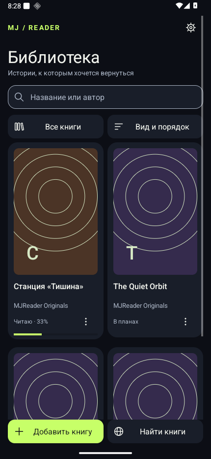
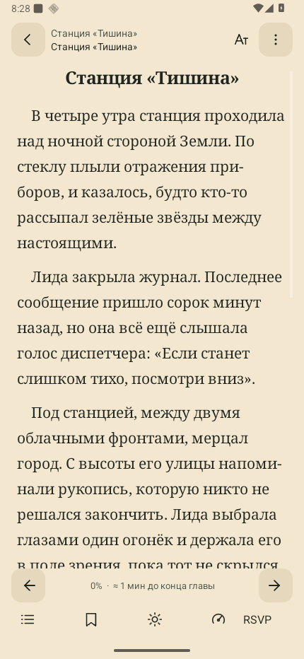
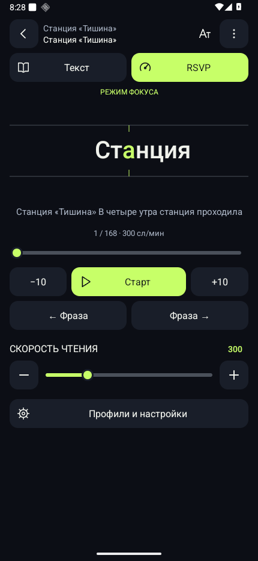
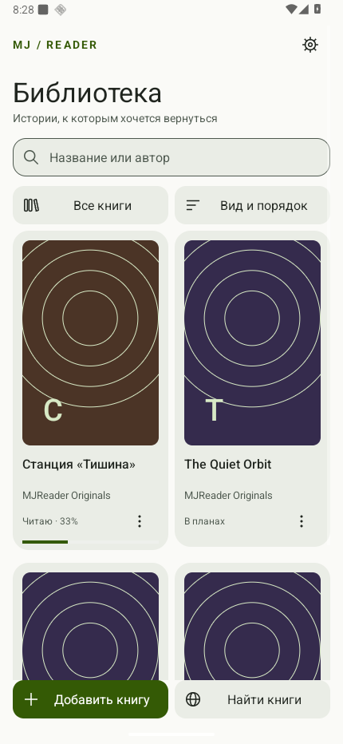
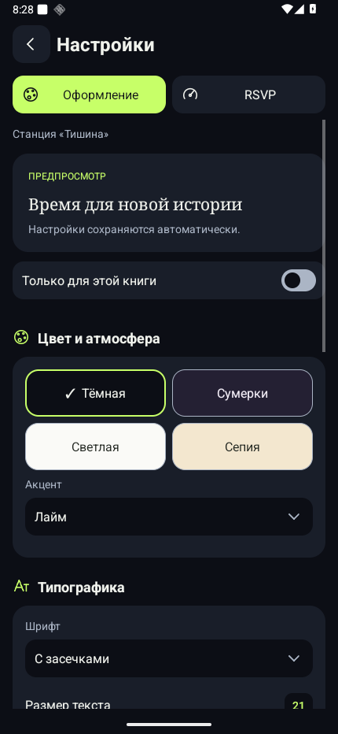
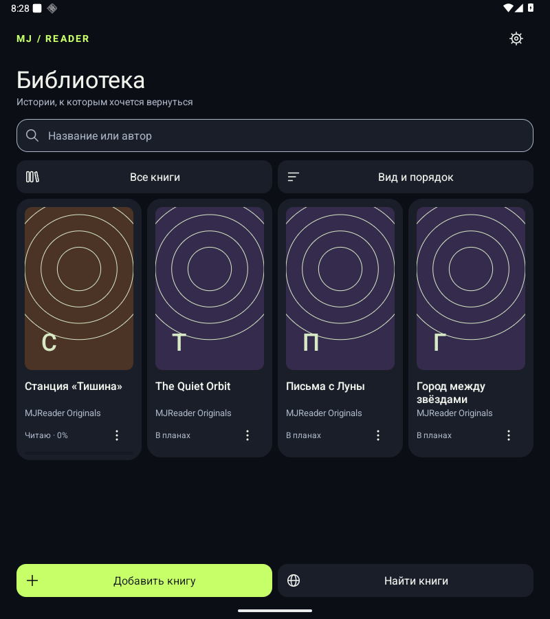
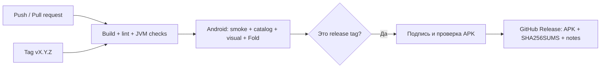

<p align="center"></p>

<p align="center">
  <a href="https://github.com/MJSasha/mj-reader/actions/workflows/ci.yml"></a>
  <a href="https://github.com/MJSasha/mj-reader/releases"></a>
  
  
</p>

<p align="center">
  <a href="https://github.com/MJSasha/mj-reader/releases"><b>Скачать APK</b></a> ·
  <a href="#возможности">Возможности</a> ·
  <a href="#сборка">Сборка</a> ·
  <a href="docs/TESTING.md">Тестирование</a> ·
  <a href="AGENTS.md">Для AI-агентов</a>
</p>

**MJReader** — нативная читалка для Android с собственной библиотекой, четырьмя темами,
режимом RSVP на русском и английском и каталогом книг с загрузкой прямо в приложение.
Интерфейс адаптируется к телефону, раскрытому Fold и планшетному окну.

*Native Android EPUB/TXT reader with bilingual RSVP, adaptive layouts and an OPDS catalog.
Built with Java and Android Views, without runtime third-party dependencies.*

## Как выглядит

<table>
  <tr>
    <td align="center"><b>Библиотека · тёмная</b></td>
    <td align="center"><b>Чтение · сепия</b></td>
    <td align="center"><b>RSVP · свой темп</b></td>
  </tr>
  <tr>
    <td></td>
    <td></td>
    <td></td>
  </tr>
</table>

<details>
<summary><b>Светлая тема, настройки и раскрытый Fold</b></summary>

<table><tr>
<td></td>
<td></td>
</tr></table>



</details>

Снимки получены из работающего приложения на эмуляторе. Тексты — оригинальные
демоистории MJReader, названия дополнительных карточек — демонстрационные.

## Возможности

| Область | Что умеет |
| --- | --- |
| **Библиотека** | Сетка обложек или список, поиск, сортировка, избранное, коллекции, статусы чтения, редактирование названия/автора |
| **Импорт** | EPUB без DRM, TXT, несколько файлов за раз, обложки и оглавление, обнаружение дубликатов и восстановление метаданных |
| **Чтение** | Шрифты, размер, интерлиньяж, поля, выравнивание, переносы, абзацы, полноэкранный режим, поиск, закладки и цитаты |
| **RSVP** | 100–900 слов/мин, опорная буква, паузы на пунктуации и длинных словах, отсчёт, перемотка, профили RU/EN |
| **Оформление** | Тёмная, Сумерки, Светлая и Сепия; четыре акцента; общие настройки и переопределения для отдельной книги |
| **Каталог** | Флибуста/OPDS, поиск названий и авторов, разделы, подгрузка при прокрутке, проверяемые HTTPS-зеркала |
| **Загрузки** | EPUB/TXT внутри приложения, фоновый перенос, прогресс, отмена/повтор и автоматический импорт |
| **Fold и планшет** | Сетка до шести колонок, двухколоночный каталог, комфортная ширина текста, сохранение места при изменении окна |

### Удобные мелочи

- Нажатие на карточку открывает книгу. Долгое нажатие или **⋮** — её меню; лишней кнопки «Читать» нет.
- Удаление обратимо через фильтр **«Удалённые»**.
- Нажатие в центре текста скрывает панели; оглавление, поиск и закладки доступны из меню чтения.
- Page Up / Page Down перелистывают текст или предложения RSVP. Клавиши громкости можно назначить для листания.
- RSVP автоматически ставится на паузу при уходе в фон.
- Контролы имеют отдельные состояния нажатия, наведения и фокуса. Индикатор открытия уважает отключение системных анимаций.
- Большая книга размечается фрагментами около 18 тысяч символов, а не целиком при каждом открытии.

## Установка

1. Откройте [Releases](https://github.com/MJSasha/mj-reader/releases) и выберите нужную версию.
2. В **Assets** скачайте `MJReader-X.Y.Z.apk`.
3. Откройте APK на устройстве с Android 8.0 или новее. При необходимости разрешите установку из выбранного приложения.
4. Новые версии устанавливайте **поверх** старой: сертификат сохраняется, библиотека остаётся на месте.

Версии 0.x — предварительные. `SHA256SUMS` в релизе содержит контрольную сумму APK.
Удаление самого приложения удаляет его приватную библиотеку и настройки.

## Форматы, данные и ограничения

- TXT: UTF-8, UTF-16 с BOM и Windows-1251. EPUB: текст, растровая обложка и главы.
- Лимит — 32 МБ на импорт, включая распакованное содержимое EPUB.
- Исходная CSS-вёрстка, иллюстрации внутри глав, DRM, PDF/FB2 и чисто векторные SVG-обложки пока не поддерживаются.
- Книги и настройки хранятся в приватной папке приложения. Для локального чтения интернет не нужен.
- Облачной синхронизации и экспортного резервного копирования пока нет.
- Повторная загрузка начинается с нуля; HTTP Range-докачка не реализована.
- Каталог сохраняет страницы при изменении конфигурации. После завершения процесса системой он запрашивается заново.
- Адаптация проверена в окнах эмулятора; отдельная раскладка Flex Mode по датчику шарнира пока не реализована.

### Флибуста и зеркала

**Найти книги → шестерёнка** открывает список зеркал. Авто выбирает доступный адрес,
запоминает его и переключается при сбое. Собственный HTTPS OPDS-адрес включается в
список только после успешной проверки с устройства. Автопоиска неизвестных зеркал
по всему интернету нет; доступность зависит от сайта и сети.

Каталог показывает кнопку скачивания при наличии прямой EPUB/TXT-ссылки.
Торрент-клиент и magnet-ссылки были удалены из приложения в 0.7.0.

## Сборка

**Нужно:** JDK 17, Python 3.10+, Android SDK Platform 36, Build Tools 35.0.0.
Gradle 8.13 скачивается проверяемым Wrapper; AGP — 8.13.2.

```sh
git clone git@github.com:MJSasha/mj-reader.git
cd mj-reader
export ANDROID_HOME=/path/to/Android/sdk
./gradlew assembleDebug
```

Либо укажите `sdk.dir` в локальном, неотслеживаемом `local.properties`.
APK: `app/build/outputs/apk/debug/app-debug.apk`.

```sh
# JVM/Python checks + Android build + lint
bash scripts/checks.sh

# После установки app/test APK на выделенный эмулятор
python3 scripts/android-checks.py --device emulator-5554
```

[Подготовка эмулятора, отдельные наборы тестов и скриншоты →](docs/TESTING.md)

## CI и выпуск версий



- **Checks** работает для `main` и pull request. Логи, JUnit, lint и скриншоты сохраняются в artifacts.
- **Release** запускается по тегу `vX.Y.Z` и повторно проверяет точный commit перед публикацией.
- Версия задаётся в `version.properties`; Android versionCode увеличивается с каждым выпуском.
- Подпись хранится в GitHub Secrets. В публичном Git нет APK, приватных ключей, личных книг и SDK-путей.
- Actions закреплены по commit SHA; Dependabot предлагает обновления.

[Настройка подписи, выпуск и восстановление после ошибок →](docs/RELEASING.md)

## Для разработчиков и AI-агентов

| Документ | Назначение |
| --- | --- |
| [AGENTS.md](AGENTS.md) | Короткие рабочие инструкции, команды, инварианты и карта файлов |
| [Architecture](docs/ARCHITECTURE.md) | Ответственность классов, хранение, жизненный цикл и сетевые потоки |
| [Testing](docs/TESTING.md) | Воспроизводимые проверки, ограничения эмулятора, собственные fixtures |
| [Releasing](docs/RELEASING.md) | Secrets, теги, подпись, APK и recovery |
| [Design system](design-system/mjreader/MASTER.md) | Нативные контролы, темы, доступность и адаптация |
| [Contributing](CONTRIBUTING.md) | Подготовка изменений и pull request |
| [Changelog](CHANGELOG.md) | История версий |

Код — Java + Android Views, один Gradle-модуль, без сторонних runtime-зависимостей.
Исходники публичны; лицензия на распространение и модификацию пока не выбрана.
