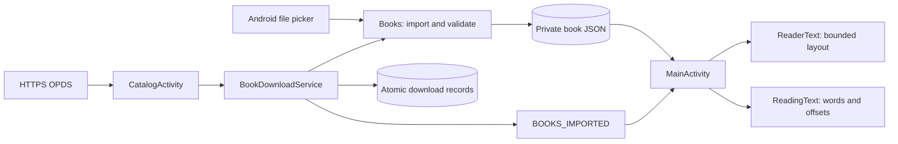

# Architecture

MJReader deliberately uses Android framework Views and Java, without a WebView,
Compose, a database library or a torrent runtime. It is a single `:app` Gradle module.

## Ownership

| Component | Responsibility | Important boundary |
| --- | --- | --- |
| `MainActivity` | Library, book actions, text reader, RSVP, per-book/global settings | UI thread owns route state; worker handles import/open |
| `Books` | EPUB/FB2/TXT decoding, deduplication, metadata repair and private JSON files | Serialized import; stable ID/full-text offsets |
| `Fb2` | FictionBook metadata, body/notes, chapters and embedded raster assets | Shared protected XML parser; original full-text offsets |
| `BookNotes` | Local EPUB anchor targets and bounded footnote text | No network access; retained original text offsets |
| `EpubCover` | EPUB cover candidates, wrappers and raster decoding | Bounded input; no remote image fetch |
| `ReadingText` | RU/EN word boundaries, offsets, RSVP delay | Pure Java; checked on the host JVM |
| `ReaderText` | Chapter/paragraph/image spans and an approximately 18k-character window | Window-relative UI offsets map back to full text |
| `ReaderPages` | One/two native page layouts, arrow/edge-tap controls and accessible page turns | Layout/image decoding on the worker; exact full-text page boundaries |
| `ReaderOptions` | JSON settings, semantic colors, interaction states, resize observation | Shared by main reader and catalog |
| `ReaderDialogs` / `ReaderIcon` | Branded native menus and vector-drawn symbols | Scrolling actions, keyboard and accessibility |
| `CatalogActivity` | Query, tabs, results, pagination, download status | No duplicate page loads; stale request generations ignored |
| `Flibusta` | HTTPS, OPDS, known/custom mirrors, bounded retries | Atom/XML validation; no HTML scraping or browser execution |
| `BookDownloads` | Atomic transfer records | One lock for record updates; SHA-256 URL identity |
| `AppUpdates` / `UpdateActivity` | GitHub releases, APK validation, update UI | Android DownloadManager persists transfers; Package Installer requires user confirmation |
| `BookDownloadService` | Serial background downloads and import | Foreground data-sync service; cancel closes the connection |

## Data flows

## Storage

- `files/books/<id>.json`: title, author, full normalized text, chapter anchors,
  optional base64 raster cover, deduplicated inline image assets, footnote ranges/text and full-text image positions, fingerprint. No external storage permission is required.
- SharedPreferences `reader`: global JSON `options`, optional `options.<bookId>`,
  book metadata/status, full-text anchors, bookmarks, collections, catalog configuration.
- `files/downloads/<url-sha256>/job.json`: transfer state/progress, source URL, book ID.
  Temporary payloads stay inside that directory and are removed after successful import.
- Deleting a book in the UI is reversible; it changes the library filter/state.
  Uninstalling the app removes its private data. There is no cloud sync or export backup yet.

EPUB/FB2 cover/navigation/illustration/footnote repair may enrich an existing entry. Older imports
did not retain inline images, so restoring them requires reimporting the original book. It must not replace the
original text or reset identity just because better metadata became available.

## UI and window changes

The UI is composed programmatically. Library rows are virtualized with `ListView`.
Columns depend on window width and font scale. Paged reading uses one page on phones
and two pages from 640 dp of available reader width (more for large system fonts).
Each page lays out at most 18k characters, and only visible illustrations decode pixels.
Continuous scrolling is the default and keeps a 700 dp maximum measure; the reading-mode selector enables pages. Scroll has no footer arrows. Pages turn via arrows or taps in the outer 25% on either side; center taps toggle controls. Turns use a 180 ms horizontal slide of bounded layouts, without bitmap textures or swipe gestures; reduced motion disables the slide. Catalog uses two columns from 720 dp unless large fonts require a list.

Large changes use saved instance state / Activity recreation. Catalog results and
loaded-page identities also survive configuration changes through non-configuration state.
After process death the feed is requested again; this is not a persistent network cache.

Small size changes may not recreate the Activity. `ReaderOptions.observeWindow`
rebuilds the relevant route from its retained state and ignores IME-only size changes.
Do not derive adapter column counts dynamically while an existing ListView is measuring.

## Network and cancellation

Catalog reads use HTTPS with certificate verification. OPDS input is bounded and parsed
using the shared XML protections. Only explicit EPUB/FB2/TXT acquisition links can be downloaded.
The parser never executes a catalog page or book script.

Known/user-validated mirrors participate in automatic fallback. Catalog requests give the preferred
mirror a 600 ms head start, then race at most two requests; the first valid feed wins.
A 20-second scheduling budget bounds three retry rounds. Cancellation disconnects active
connections, freeing the catalog worker for a new search. Eight feeds are cached for 20 seconds
by exact URL. Permanent HTTP/XML errors do not retry the same mirror.
Live availability is not guaranteed by a successful previous check.

Downloads are serialized, capped at 32 MB and persisted. Up to three automatic attempts recover transient network errors and truncated streams, switching known mirror origins. Each attempt restarts the file from zero;
HTTP Range resume is not implemented. Process interruption is shown in the downloads UI
and requires user retry. A completed import notifies the visible library by local broadcast.

## Dependencies and changes

Prefer the platform/standard library or existing helpers. Add a dependency only for a
concrete requirement. Keep parser, presentation and transfer responsibilities in their
current owners; a UI cleanup should not rewrite storage or change the signing identity.

Android VIEW/SEND content URIs use the existing background import queue; duplicates open the stored book ID. Pending URIs survive Activity recreation. Footnote taps take precedence over edge navigation, open the existing themed dialog, and never change the reader anchor. Screen readers expose footnotes as custom actions.

## App updates

`AppUpdates` reads a bounded (2 MB) public GitHub releases response on its worker, includes published 0.x prereleases and selects the highest newer numeric version with a complete APK asset. Only exact repository asset URLs with a SHA-256 digest and a declared size of at most 32 MB qualify. Automatic checks are throttled to once per day when entering the library, and can be disabled independently of book settings. Network failure does not interrupt reading.

The user starts downloads from `UpdateActivity`. Android DownloadManager owns retries, background execution and transfer persistence. SharedPreferences `updates` stores cached release metadata and the active transfer ID/pending metadata. The APK is in app-specific external downloads; cancel/retry removes the tracked transfer. On completion and again before installation, the worker checks length, SHA-256, package `com.mjreader`, expected version name, an increased version code, a non-debuggable package and the exact installed signing certificate set. No new signing identity is accepted. An installer receives only a content URI with a temporary read grant. Unknown-source permission is requested through Android settings; returning never silently starts installation. Recreation rereads the persisted transfer and revalidates it.
