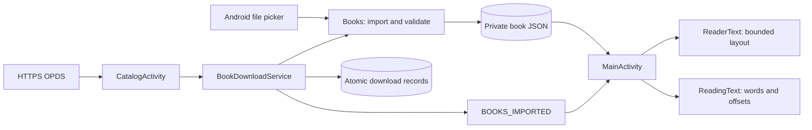

# Architecture

MJReader deliberately uses Android framework Views and Java, without a WebView,
Compose, a database library or a torrent runtime. It is a single `:app` Gradle module.

## Ownership

| Component | Responsibility | Important boundary |
| --- | --- | --- |
| `MainActivity` | Library, book actions, text reader, RSVP, per-book/global settings | UI thread owns route state; worker handles import/open |
| `Books` | EPUB/TXT decoding, deduplication, metadata repair and private JSON files | Serialized import; stable ID/full-text offsets |
| `EpubCover` | EPUB cover candidates, wrappers and raster decoding | Bounded input; no remote image fetch |
| `ReadingText` | RU/EN word boundaries, offsets, RSVP delay | Pure Java; checked on the host JVM |
| `ReaderText` | Chapter/paragraph spans and an approximately 18k-character window | Window-relative UI offsets map back to full text |
| `ReaderOptions` | JSON settings, semantic colors, interaction states, resize observation | Shared by main reader and catalog |
| `ReaderDialogs` / `ReaderIcon` | Branded native menus and vector-drawn symbols | Scrolling actions, keyboard and accessibility |
| `CatalogActivity` | Query, tabs, results, pagination, download status | No duplicate page loads; stale request generations ignored |
| `Flibusta` | HTTPS, OPDS, known/custom mirrors, bounded retries | Atom/XML validation; no HTML scraping or browser execution |
| `BookDownloads` | Atomic transfer records | One lock for record updates; SHA-256 URL identity |
| `BookDownloadService` | Serial background downloads and import | Foreground data-sync service; cancel closes the connection |

## Data flows

## Storage

- `files/books/<id>.json`: title, author, full normalized text, chapter anchors,
  optional base64 raster cover, fingerprint. No external storage permission is required.
- SharedPreferences `reader`: global JSON `options`, optional `options.<bookId>`,
  book metadata/status, full-text anchors, bookmarks, collections, catalog configuration.
- `files/downloads/<url-sha256>/job.json`: transfer state/progress, source URL, book ID.
  Temporary payloads stay inside that directory and are removed after successful import.
- Deleting a book in the UI is reversible; it changes the library filter/state.
  Uninstalling the app removes its private data. There is no cloud sync or export backup yet.

EPUB cover/navigation repair may enrich an existing entry. It must not replace the
original text or reset identity just because better metadata became available.

## UI and window changes

The UI is composed programmatically. Library rows are virtualized with `ListView`.
Columns depend on window width and font scale; text reading keeps a 700 dp maximum
measure. Catalog uses two columns from 720 dp unless large fonts require a list.

Large changes use saved instance state / Activity recreation. Catalog results and
loaded-page identities also survive configuration changes through non-configuration state.
After process death the feed is requested again; this is not a persistent network cache.

Small size changes may not recreate the Activity. `ReaderOptions.observeWindow`
rebuilds the relevant route from its retained state and ignores IME-only size changes.
Do not derive adapter column counts dynamically while an existing ListView is measuring.

## Network and cancellation

Catalog reads use HTTPS with certificate verification. OPDS input is bounded and parsed
using the shared XML protections. Only explicit EPUB/TXT acquisition links can be downloaded.
The parser never executes a catalog page or book script.

Known/user-validated mirrors participate in automatic fallback. Transient failures retry
up to three rounds with backoff and a 40-second scheduling budget; an in-flight request
can finish after that budget. Permanent HTTP/XML errors do not retry the same mirror.
Live availability is not guaranteed by a successful previous check.

Downloads are serialized, capped at 32 MB and persisted. Retry restarts the file from zero;
HTTP Range resume is not implemented. Process interruption is shown in the downloads UI
and requires user retry. A completed import notifies the visible library by local broadcast.

## Dependencies and changes

Prefer the platform/standard library or existing helpers. Add a dependency only for a
concrete requirement. Keep parser, presentation and transfer responsibilities in their
current owners; a UI cleanup should not rewrite storage or change the signing identity.
